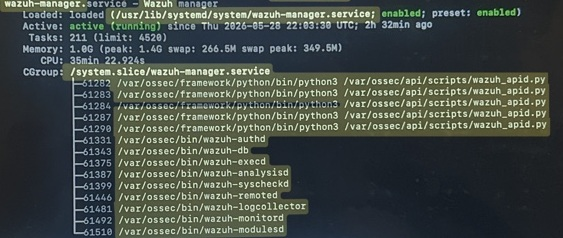
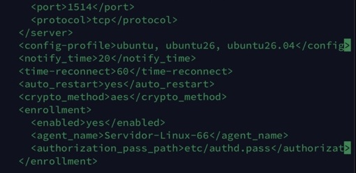
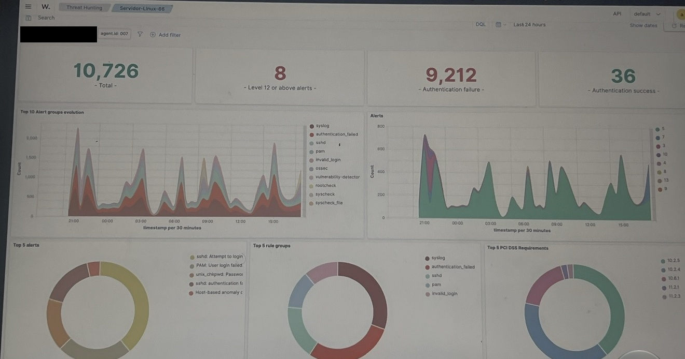

# Deploying a Wazuh server and connecting a Linux endpoint

**Alejandro Báez Santana · Cloud infrastructure and endpoint monitoring lab · May 2026**

I deployed a Wazuh manager on Ubuntu and configured a remote Linux endpoint to send it security events. To validate the deployment, I checked the manager service on the server, then located the configured endpoint in Wazuh's Threat Hunting dashboard.

## Verify the server

I used the EC2 console to check the instance type during a resize. The console showed a stopped `t3.medium` instance. On May 28, I checked `systemctl status wazuh-manager` on Ubuntu. The service was enabled and running, and the process tree included the analysis, remote communication and log collection daemons. [EC2 instance capture](ec2-instance.jpg)

## Connect the Linux endpoint

In the agent's `ossec.conf`, I set the manager transport to TCP on port 1514 and the enrollment name to `Servidor-Linux-66`. The editor capture records those settings. The dashboard gives a separate check on the collection path: the same endpoint appears as agent `007` with security events in its 24-hour view.

## Confirm telemetry in the dashboard

The filtered view recorded **10,726 total alerts**. Wazuh displayed 9,212 authentication failures, 36 authentication successes and eight alerts at level 12 or higher. I used this view to verify that endpoint activity was visible centrally. Investigating a specific login would require its underlying event.

## Deployment troubleshooting

| Observation | What it established |
| --- | --- |
| Ubuntu rejected the endpoint agent package on the manager host. | The package manager identified an installed Wazuh manager package and reported a conflict. Checking the manager service separately confirmed the server role. [Package output](package-conflict.jpg) |
| The macOS agent started its local processes. | The original terminal session also reported a duplicate agent name during enrollment. Local startup is documented; successful central enrollment on the Mac remains unverified. [macOS startup output](mac-agent.jpg) |

All six images are excerpts from my original lab captures. I cropped them to keep the relevant output visible and remove infrastructure identifiers and unrelated screen content.
